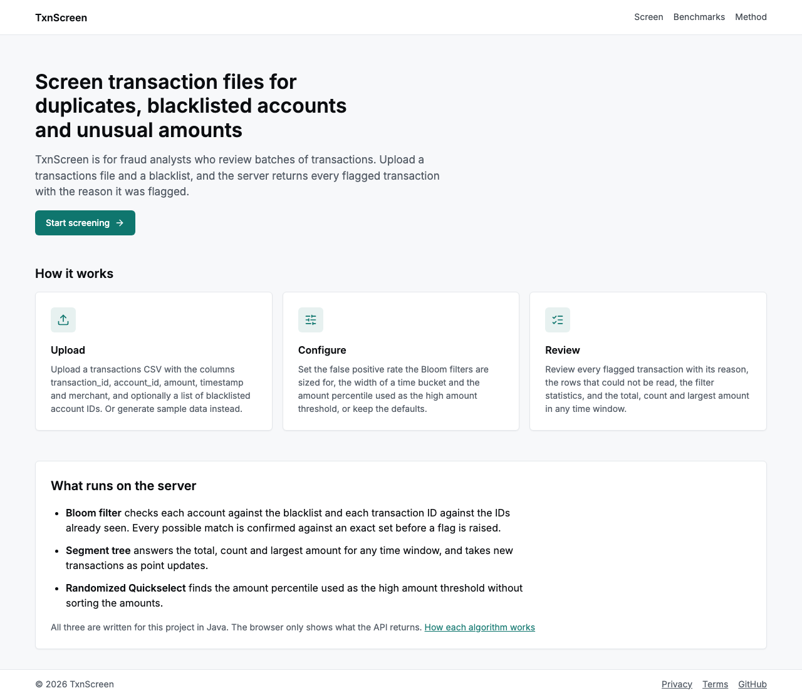
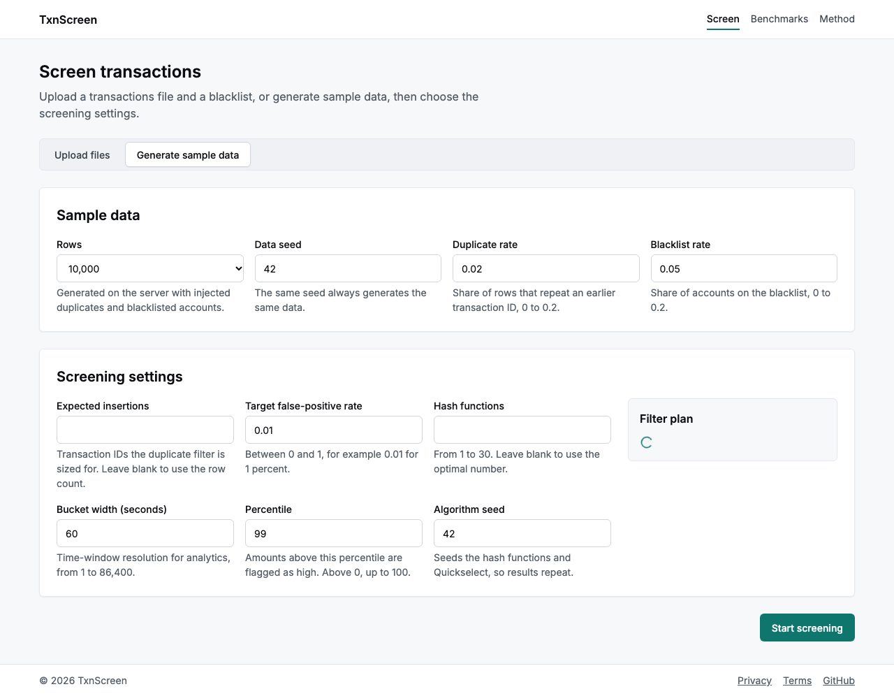
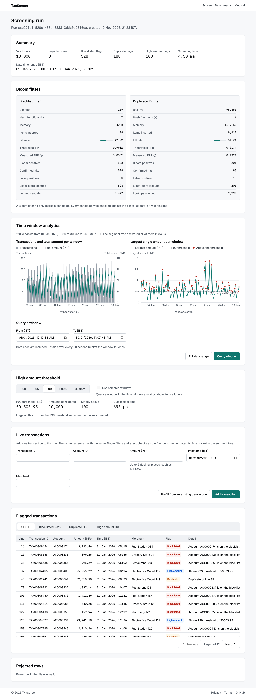
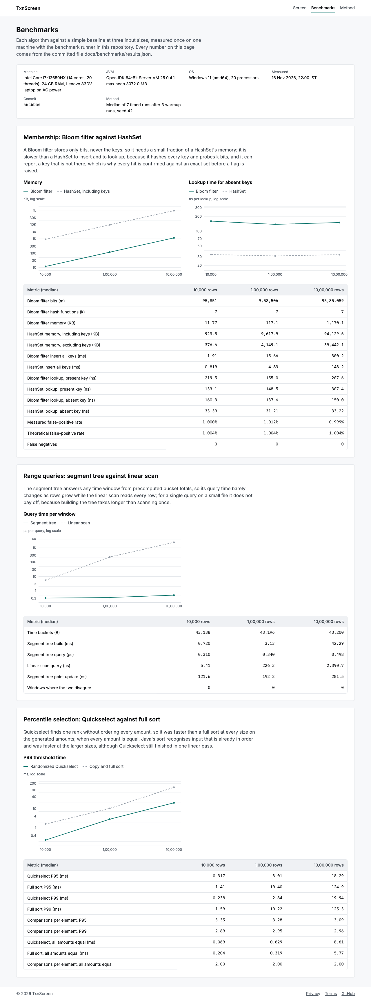
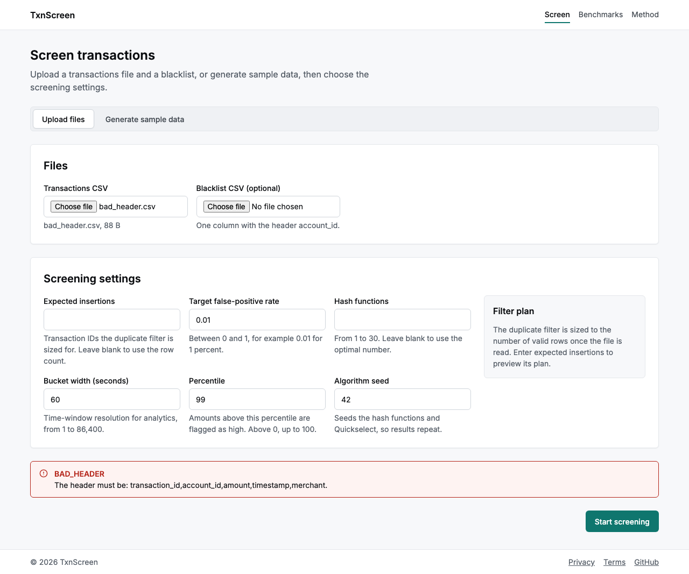
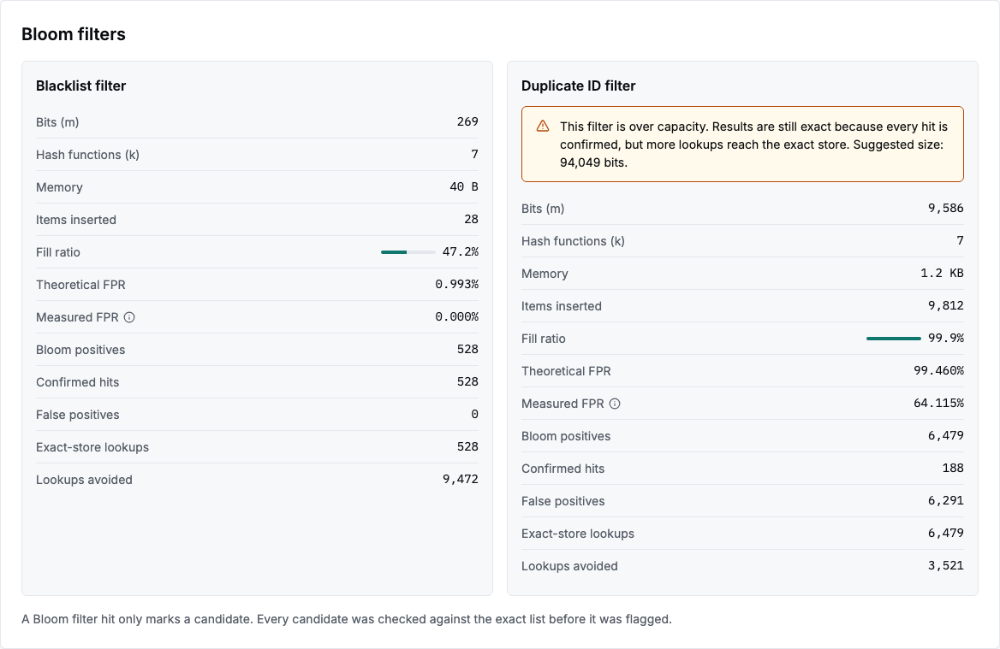

# TxnScreen

[](https://github.com/Krrishkothari/Fraud-and-Duplicate-Transaction-Screener/actions/workflows/ci.yml)

TxnScreen is a web app for fraud analysts that screens a file of transactions. The analyst
uploads a transactions CSV and a blacklist of account IDs, or generates sample data, and sets the screening
parameters. The app flags duplicate transaction IDs, transactions from blacklisted accounts, and amounts
above a percentile risk threshold, and shows totals for any time window. Three algorithms we wrote ourselves
in Java do the work on the server: a Bloom filter whose hits are always confirmed against an exact list, a
segment tree over time buckets, and randomized Quickselect. The React frontend only displays what the API
returns. This is an academic project for the Advanced Algorithm course (CIA 3), ATLAS uGDX School of
Technology.

## Features

- **Upload or generate data.** Upload a transactions CSV of up to 200,000 rows with an optional blacklist,
  or generate seeded synthetic data of 1,000 to 200,000 rows on the server.
- **Configure the screen.** Set the expected insertions, target false positive rate, hash count, time
  bucket width, percentile and seed. A live filter plan shows the Bloom filter's bits, hash count, memory
  and theoretical false positive rate before the run starts.
- **Flagged transactions.** Filter by `BLACKLISTED`, `DUPLICATE` or `HIGH_AMOUNT`, page through the
  results, and see why each was flagged. A duplicate names the line of its first occurrence.
- **Rejected rows.** Every invalid row is listed with its line number and reason, and the rest of the file
  is still screened.
- **Bloom filter statistics.** Bits, hash count, fill ratio, measured and theoretical false positive rate,
  confirmed hits, false positives and the exact lookups avoided, with a warning when a filter is saturated.
- **Time-window analytics.** Charts of count, total and largest amount over time, and the sum, count and
  maximum for any window, with the query time in microseconds.
- **Risk threshold.** The percentile amount for the whole run or one window, and how many amounts are above
  it.
- **Live transactions.** Add one transaction to a run and see it screened and counted in its time window.
- **Benchmarks.** Each algorithm against a simple baseline at 10K, 100K and 1M rows, from measured results
  committed to the repository.

## How it works

| Algorithm | Where it is used | Cost |
| --- | --- | --- |
| Bloom filter with MurmurHash3 and double hashing | Precheck for blacklisted accounts and duplicate transaction IDs. A "possibly present" answer is confirmed against an exact store before a flag is raised | O(k) per check, about 9.6 bits per key at a 1% false positive rate |
| Segment tree over time buckets | Sum, count and maximum for any time window, and point updates for live transactions | O(log B) per query or update, for B buckets |
| Randomized Quickselect with three-way partition | The percentile amount that sets the `HIGH_AMOUNT` threshold, for the whole run or one window | Expected O(n) |

Each one has a section in the technical report under [docs/report/](docs/report/).

## Screenshots

Captured from a local build with the API's real responses. The run pages use the generated 10,000-row sample
with seed 42.

**Home.** What the app does and which algorithm runs each step.



**Screen.** Generated sample data selected, with the screening settings and the live Bloom filter plan.



**Run.** The summary, both Bloom filters' statistics, the time-window charts and window query, the high amount
threshold, the live transaction form, the flagged transactions and the rejected rows.



**Benchmarks.** Each algorithm against its baseline at 10,000, 100,000 and 1,000,000 rows, drawn from
[docs/benchmarks/results.json](docs/benchmarks/results.json).



**Error state.** A transactions file with the wrong header is rejected with the API's `BAD_HEADER` error and
its message.



**Saturation warning.** The same sample with expected insertions set to 1,000. The duplicate ID filter holds
9,812 IDs in 9,586 bits, so it reports that it is over capacity and suggests 94,049 bits. It still confirmed
the same 188 duplicates as the default run, because every hit is checked against the exact store.



## Tech stack

| Layer | Choice |
| --- | --- |
| Backend | Java 21, Spring Boot 4.1, Maven (wrapper included) |
| CSV parsing | Apache Commons CSV |
| Tests | JUnit 5, Spring MockMvc |
| Memory measurement | JOL, in the benchmarks |
| Hash verification | Guava, in test scope only, to check our MurmurHash3 output |
| Frontend | React 19, Vite, TypeScript, React Router |
| Charts and icons | Recharts, lucide-react |
| CI | GitHub Actions: `mvnw verify` and the frontend lint and build on every push and pull request |
| Hosting | Vercel for the frontend, Render (Docker) for the API |

No library Bloom filter, segment tree, percentile or selection routine is used. All three are in
`backend/src/main/java/com/txnscreen/algo/`.

## Repository layout

```
backend/            Spring Boot API, algorithms, tests, benchmarks, Dockerfile
  src/main/java/com/txnscreen/
    algo/           bloom/, segtree/, select/: the three algorithms
    api/            REST controllers, request and response records, error handling
    service/        screening, analytics, threshold, live append, run store
    ingest/         CSV and blacklist parsing and row validation
    data/           seeded synthetic data generator
    baseline/       HashSet, linear scan and full sort baselines
    bench/          benchmark runner
frontend/           React app
data/samples/       committed sample files: 1K and 10K rows, blacklists, labels, edge cases
docs/               API reference, deployment guide, report sections, benchmark results, screenshots
scripts/dev.mjs     starts the backend and frontend together
render.yaml         Render blueprint for the API
```

## Prerequisites

- JDK 21 or later
- Node.js 22 (CI uses 22; the root `npm run dev` needs at least 20)
- Git

Maven does not need to be installed: the backend uses the Maven wrapper (`./mvnw`, or `mvnw.cmd` on
Windows).

## Run locally

Clone the repository and start both parts with one command from the repository root:

```bash
git clone https://github.com/Krrishkothari/Fraud-and-Duplicate-Transaction-Screener.git
cd Fraud-and-Duplicate-Transaction-Screener
npm run dev
```

This installs the frontend's dependencies if needed, then starts the API on http://localhost:8080 and the
frontend on http://localhost:5173. Their output is shown with `backend` and `frontend` prefixes, and Ctrl+C
or closing the terminal stops both. The first start downloads the Maven dependencies, which takes a few
minutes. If a server from an earlier `npm run dev` is still holding one of the two ports, it is stopped
first; if another program holds a port, the script names it and exits.

Open http://localhost:5173, go to **Screen**, and either choose **Generate sample data** or upload
`data/samples/transactions_1000.csv` with `data/samples/blacklist_1000.csv`.
`data/samples/edge_cases.csv` shows how invalid rows are rejected.

### Or start each part separately

Backend, in one terminal:

```bash
cd backend
./mvnw spring-boot:run
curl http://localhost:8080/api/health    # {"status":"ok"}
```

Frontend, in another:

```bash
cd frontend
npm ci
npm run dev
```

In development the Vite server forwards `/api` to `http://localhost:8080`, so the frontend needs no
environment variables. `frontend/.env.example` shows the one variable used when the frontend and API are on
different origins.

### Run the API in Docker

```bash
docker build -t txnscreen-api backend
docker run --rm -p 8080:8080 -e ALLOWED_ORIGINS=http://localhost:5173 txnscreen-api
```

## Environment variables

None of these is a secret. The app has no database, accounts or API keys.

| Name | Part | Default | Meaning |
| --- | --- | --- | --- |
| `VITE_API_BASE_URL` | Frontend, at build time | empty: same origin, through the Vite proxy in development | Base URL of the API, with no trailing slash, such as `https://txnscreen-api.onrender.com` |
| `ALLOWED_ORIGINS` | Backend | `http://localhost:5173` | Comma-separated frontend origins allowed to call `/api/**` from a browser |
| `PORT` | Backend | `8080` | Port the API listens on. Render sets it |

## Sample data

The committed samples in `data/samples/` were made with seed 42:

| File | Contents |
| --- | --- |
| `transactions_1000.csv`, `transactions_10000.csv` | Synthetic transactions over 30 days from 1 Jan 2026, with injected duplicates |
| `blacklist_1000.csv`, `blacklist_10000.csv` | Blacklisted account IDs, including some that never appear in the data |
| `labels_1000.csv`, `labels_10000.csv` | Ground truth for each row: whether it is a duplicate and whether its account is blacklisted |
| `edge_cases.csv` | 17 hand-written rows: 5 invalid (negative and zero amounts, a bad timestamp, a missing field, 3 decimals), 2 duplicates, the rest valid |

The CSV header is `transaction_id,account_id,amount,timestamp,merchant`. Amounts are rupees with at most 2
decimal places, and timestamps are ISO-8601 with an offset, such as `2026-03-14T09:26:53+05:30`. A
blacklist has one column, `account_id`.

### Generate 10K, 100K and 1M datasets

Larger files are not committed. Generate them from the same seed, from `backend/`:

```bash
cd backend
./mvnw -q compile
java -cp target/classes com.txnscreen.data.GeneratorCli --size 10000 --seed 42 --out-dir ../data/generated
java -cp target/classes com.txnscreen.data.GeneratorCli --size 100000 --seed 42 --out-dir ../data/generated
java -cp target/classes com.txnscreen.data.GeneratorCli --size 1000000 --seed 42 --out-dir ../data/generated
```

Each command writes `transactions_<size>.csv`, `blacklist_<size>.csv` and `labels_<size>.csv`. The same
size and seed always give the same files. `--duplicate-rate` and `--blacklist-rate` default to 0.02 and
0.05. `data/generated/` is ignored by git. Uploads are limited to 200,000 rows, so the 1M file is for the
benchmarks and local experiments only.

## Tests

Backend: unit tests for each algorithm and API tests through Spring MockMvc.

```bash
cd backend
./mvnw verify                          # every test
./mvnw test -Dtest=SegmentTreeTest     # one test class
```

Frontend: lint and type-checked production build.

```bash
cd frontend
npm run lint
npm run build
```

CI runs both on every push to `main` and every pull request.

## Benchmarks

The benchmarks compare the Bloom filter with a `HashSet`, the segment tree with a linear scan, and
Quickselect with a full sort, at 10,000, 100,000 and 1,000,000 rows. They run locally, not on the server.
From `backend/` in Git Bash:

```bash
export MAVEN_OPTS=-Xmx3g
./mvnw -q compile exec:java -Dexec.mainClass=com.txnscreen.bench.BenchmarkRunner \
  -Dexec.args="--sizes 10000,100000,1000000 --repeats 7 --warmup 3 --seed 42 \
  --machine 'your CPU and RAM' --commit $(git rev-parse --short HEAD) --out ../docs/benchmarks/results.json"
```

In PowerShell, set the heap with `$env:MAVEN_OPTS="-Xmx3g"` instead. The committed results are in
[docs/benchmarks/results.json](docs/benchmarks/results.json), measured on the machine described in
[docs/benchmarks/machine.md](docs/benchmarks/machine.md). The frontend copies that file at build time and
the Benchmarks page draws its charts and tables from it.

## Documentation

- [docs/api.md](docs/api.md): every endpoint, with a curl example and a real response
- [docs/deployment.md](docs/deployment.md): deploying the API to Render and the frontend to Vercel
- [docs/report/TxnScreen_Technical_Report.pdf](docs/report/TxnScreen_Technical_Report.pdf): the technical
  report, condensed from the full sections in [docs/report/](docs/report/)
- [docs/demo-script.md](docs/demo-script.md): the 8-minute demo, with the values each step should show
- [docs/launch-checklist.md](docs/launch-checklist.md): what has been checked before launch, and what is
  still open
- [docs/benchmarks/machine.md](docs/benchmarks/machine.md): how the benchmarks were run
- [docs/proposal.docx](docs/proposal.docx): the project proposal

## Team and contributions

Each person owns one algorithm from code to tests, benchmark and report section. Commit IDs refer to the
build plan's numbering, listed under whoever made the commit.

| Name | Algorithm | Commits |
| --- | --- | --- |
| Krrish | Bloom filter and MurmurHash3 | K01 to K13, V13, V15, plus five more: project info, the one-command `npm run dev`, transactions in flag pages, and two deployment configuration commits |
| Hardik | Segment tree and time buckets | H01 to H11, H13 to H15, K15, plus one more: a 404 response for unknown API paths |
| Vedant | Randomized Quickselect | V01 to V12, K14, V14 |

Every commit, with its hash, is listed in [docs/report/08-contributions.md](docs/report/08-contributions.md).

## License

No open source license has been chosen. The code is shared for academic assessment, and all rights remain
with its authors.
