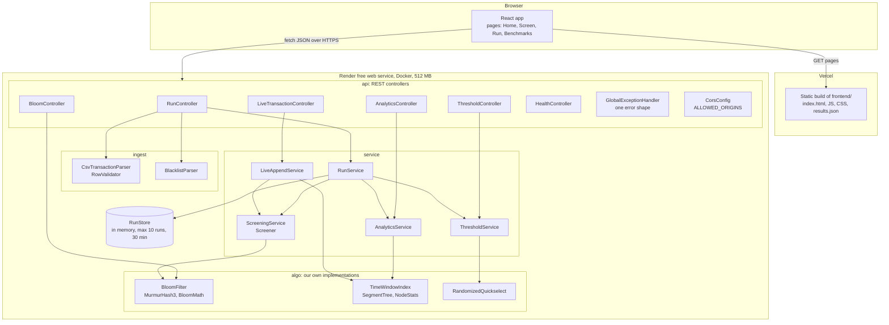
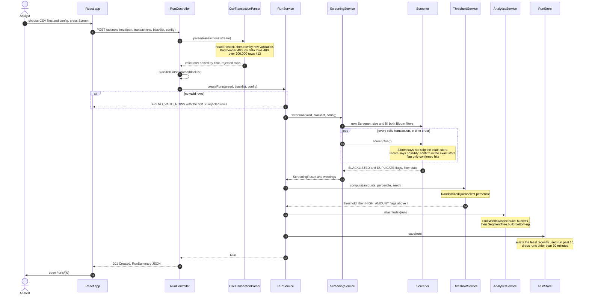
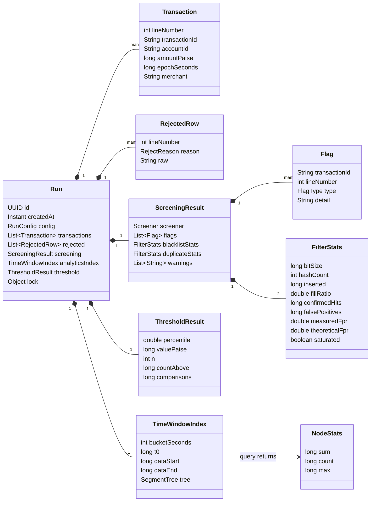

# 2. Architecture

TxnScreen has two parts. A React single-page app, built to static files and served by Vercel, and a Java 21
Spring Boot API, run as a Docker container on Render. The browser loads the app from Vercel and then calls
the API directly with `fetch`. Vercel does not run Java servers, which is why the API is hosted separately.

Every algorithm result is computed by the API. The frontend only sends requests and displays the JSON it
gets back, apart from the Benchmarks page, which reads the committed `docs/benchmarks/results.json`.

## 2.1 Components



| Package | Responsibility |
| --- | --- |
| `api` | REST controllers, request and response records, CORS, and `GlobalExceptionHandler`, which turns every exception into the `{code, message, details}` error shape |
| `ingest` | Streams the uploaded CSV with Apache Commons CSV, checks the header, validates each row into a `Transaction` or a `RejectedRow`, and parses the blacklist |
| `service` | Runs the screening pipeline, builds the analytics index, computes thresholds, appends live transactions, and stores runs |
| `algo.bloom` | `BloomFilter`, `MurmurHash3` (x64, 128-bit) and `BloomMath` (sizing formulas) |
| `algo.segtree` | `SegmentTree`, `NodeStats` and `TimeWindowIndex`, which maps timestamps to buckets |
| `algo.select` | `RandomizedQuickselect` with a three-way partition |
| `baseline` | `HashSetMembership`, `LinearRangeScan` and `SortPercentile`, used only by benchmarks and tests |
| `bench` | `BenchmarkRunner` and one benchmark per algorithm, run locally, writing `results.json` |
| `data` | `SyntheticDataGenerator` and `GeneratorCli`, seeded, for samples and benchmarks |
| `domain` | `Transaction`, `Flag`, `FlagType`, `RejectedRow`, `RejectReason` and `Money` |

The controllers never call an algorithm class directly, except `BloomController`, which only evaluates the
sizing formulas in `BloomMath` for the Screen page's live filter plan. Libraries are used only for
infrastructure: Spring Boot for HTTP and validation, Commons CSV for parsing, and Jackson for JSON. No
library Bloom filter, segment tree, percentile or selection routine is used.

## 2.2 Creating a run: POST /api/runs



The later requests on a run look it up in `RunStore` by its UUID. `GET /api/runs/{id}/window` and
`/series` query the run's `TimeWindowIndex`, `/threshold` runs Quickselect on the amounts in a time slice,
and `POST /api/runs/{id}/transactions` screens one new transaction with the same `Screener`, then applies a
segment tree point update. Window queries and live appends on the same run take the run's lock, so a query
never sees a half-applied update.

`POST /api/runs/sample` follows the same path from the `createRun` call (step 6), with rows from
`SyntheticDataGenerator` in place of the parsed upload.

## 2.3 API

Every endpoint is under `/api` and returns JSON. Endpoints that run an algorithm report its time in
microseconds (`algoMicros`, or `screenMicros` and `updateMicros` for a live append). Full request and
response examples are in [docs/api.md](../api.md).

| Method | Path | Purpose | Algorithm | Success |
| --- | --- | --- | --- | --- |
| GET | `/api/health` | Liveness check for Render and the frontend | none | 200 |
| GET | `/api/bloom/plan?n=&p=&k=` | Bits, hash count, memory and theoretical FPR for a config | Bloom sizing formulas | 200 |
| POST | `/api/runs` | Upload a transactions CSV, optional blacklist and config, and screen it | all three | 201 |
| POST | `/api/runs/sample` | Generate seeded synthetic data on the server and screen it | all three | 201 |
| GET | `/api/runs/{id}` | Run summary: counts, Bloom stats, threshold, data range, warnings | none, stored results | 200 |
| GET | `/api/runs/{id}/flags?type=&page=&size=` | One page of flagged transactions | none, stored results | 200 |
| GET | `/api/runs/{id}/transactions?page=&size=` | One page of every valid transaction with its flags | none, stored results | 200 |
| GET | `/api/runs/{id}/rejected?page=&size=` | One page of rejected rows with line number and reason | none, stored results | 200 |
| GET | `/api/runs/{id}/window?from=&to=` | Sum, count and maximum for one time window | segment tree query | 200 |
| GET | `/api/runs/{id}/series?from=&to=&points=` | Up to 500 consecutive windows for the chart | one segment tree query per window | 200 |
| GET | `/api/runs/{id}/threshold?p=&from=&to=` | Percentile amount and count above it, for the run or a window | randomized Quickselect | 200 |
| POST | `/api/runs/{id}/transactions` | Add one live transaction | Bloom screening, segment tree point update | 200 |

Every error has the same body, produced by `GlobalExceptionHandler`:

```json
{
  "code": "WINDOW_OUT_OF_RANGE",
  "message": "Window lies entirely outside the data range",
  "details": { "requestedFrom": 1700000000, "requestedTo": 1700003600, "dataStart": 1767209318, "dataEnd": 1769790596 }
}
```

| Code | Status | When |
| --- | --- | --- |
| `EMPTY_FILE` | 400 | The transactions file is empty or has only the header |
| `BAD_HEADER` | 400 | The header is not `transaction_id,account_id,amount,timestamp,merchant` |
| `MALFORMED_CSV` | 400 | The CSV quoting is broken, so rows cannot be read |
| `INVALID_CONFIG` | 400 | A config or plan value is out of range; `details.fieldErrors` names each field |
| `INVALID_WINDOW` | 400 | A window bound is not a timestamp, or the start is after the end |
| `WINDOW_OUT_OF_RANGE` | 400 | The window lies entirely outside the run's data |
| `BAD_REQUEST` | 400 | A parameter is missing or has the wrong type, or `page`, `size` or `points` is out of range |
| `MISSING_FIELD`, `INVALID_AMOUNT`, `AMOUNT_NOT_POSITIVE`, `INVALID_TIMESTAMP` | 400 | A live transaction fails row validation |
| `RUN_NOT_FOUND` | 404 | The run ID is unknown or the run has expired |
| `NOT_FOUND` | 404 | No endpoint exists at the path |
| `FILE_TOO_LARGE` | 413 | Over 200,000 data rows, or a file over 20 MB |
| `UNSUPPORTED_MEDIA_TYPE` | 415 | The request has the wrong content type |
| `NO_VALID_ROWS` | 422 | Every row of the upload was rejected |
| `EMPTY_WINDOW` | 422 | A threshold window holds no transactions |
| `TIMESTAMP_BEFORE_RANGE` | 422 | A live transaction is earlier than the run's first time bucket |
| `TOO_MANY_BUCKETS` | 422 | The time range needs more than 4,194,304 buckets at the chosen width |
| `INTERNAL_ERROR` | 500 | An unexpected error; logged on the server, no stack trace in the body |

Invalid rows inside an otherwise valid file are not errors: the run is created, and each row is listed by
`/rejected` with its line number and reason.

## 2.4 Data model



`FilterStats` has more fields than shown: `memoryBytes`, `checks`, `bloomPositives`, `suggestedBits`,
`authoritativeLookups` and `lookupsAvoided`.

- **Money** is a `long` count of paise (1 rupee = 100 paise). `Money.parseToPaise` reads amounts with at
  most 2 decimal places using integer arithmetic, so sums and comparisons are exact. No amount is ever a
  `double`.
- **Time** is a `long` count of epoch seconds, parsed from ISO-8601 timestamps with an offset, such as
  `2026-03-14T09:26:53+05:30`.
- **Line numbers** are the 1-based line of the row in the uploaded file, so the header is line 1. Live
  transactions continue the numbering after the last line of the file.
- **Flag types** are `BLACKLISTED`, `DUPLICATE` and `HIGH_AMOUNT`. One transaction can have more than one
  flag. A `DUPLICATE` flag's detail names the line of the first occurrence.
- **Reject reasons** are `MISSING_FIELD`, `INVALID_AMOUNT`, `AMOUNT_NOT_POSITIVE` and `INVALID_TIMESTAMP`.

### Run configuration

| Field | Default | Allowed | Used by |
| --- | --- | --- | --- |
| `expectedInsertions` | number of valid rows | 1 to 10,000,000 | duplicate ID Bloom filter size |
| `targetFpr` | 0.01 | greater than 0, less than 1 | both Bloom filters |
| `hashCount` | optimal k | 1 to 30 | duplicate ID Bloom filter |
| `bucketSeconds` | 60 | 1 to 86,400 | time buckets of the segment tree |
| `percentile` | 99 | greater than 0, at most 100 | risk threshold for `HIGH_AMOUNT` flags |
| `seed` | 42 | 0 to 2,147,483,647 | hash seed and Quickselect pivots |

Setting `expectedInsertions` below the real row count overfills the duplicate filter. Results stay exact,
because every Bloom hit is confirmed, and the run reports `saturated: true` with a suggested size.

## 2.5 Storage, concurrency and limits

- **No database and no disk.** `RunStore` keeps runs in a `LinkedHashMap` in access order. It holds at
  most 10 runs and evicts the least recently used one when an 11th is saved. Runs older than 30 minutes
  are removed on every access and by a scheduled sweep every 5 minutes. A restart loses every run.
- **One lock per run.** `AnalyticsService` and `LiveAppendService` hold the run's lock while they read or
  change its `TimeWindowIndex`, so window queries and live appends on the same run never interleave.
  Runs do not share state, so requests on different runs never wait for each other.
- **Sized for the free tier.** The Render free service has 512 MB of memory, so the image sets
  `-XX:MaxRAMPercentage=75`, uploads are capped at 200,000 rows and 20 MB per file, and the 1,000,000 row
  benchmarks run only locally.
- **CORS.** `CorsConfig` allows `GET` and `POST` on `/api/**` only from the origins in `ALLOWED_ORIGINS`.
