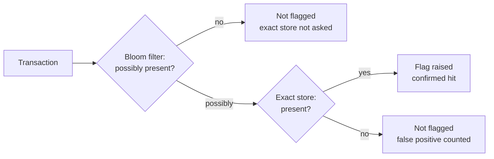

# 3. Bloom filter screening

Owner: Krrish. Code: `com.txnscreen.algo.bloom` (`BloomFilter`, `BloomMath`, `MurmurHash3`, `Hash128`)
and the screening pipeline in `com.txnscreen.service` (`Screener`, `ConfirmingFilter`,
`ExactBlacklistStore`, `SeenTransactionStore`, `ScreeningService`). Syllabus: Unit 6, CO5 (a
probabilistic data structure).

## 3.1 Why a Bloom filter for a precheck

Screening asks two membership questions about every transaction:

1. Is its account on the blacklist?
2. Has its transaction ID already been seen in this run?

For almost every transaction, both answers are no. A Bloom filter answers "definitely not present" with a
few bit lookups, in a fixed amount of memory that does not depend on how long the keys are. It never
answers no for a key that was added. It can answer "possibly present" for a key that was not added, so a
yes is only a candidate.

So the screener uses each filter as a precheck in front of an exact store. A no from the filter is final,
and the exact store is never asked. A possibly-present answer goes to the exact store, which decides. This
is the shape of a real screening service, where the exact store is a database or a shared blacklist
service, and every avoided lookup saves a network round trip. On the committed 1K sample, the blacklist
filter avoided 899 of 1,000 exact lookups and the duplicate filter avoided 984 of 1,000 (see `docs/api.md`).

## 3.2 Sizing

For n keys and a target false positive rate p, the filter has m bits and k hash functions:

```
m = ceil( -n * ln(p) / (ln 2)^2 )
k = max(1, round( (m / n) * ln 2 ))
```

After n insertions with k hash functions, a given bit is still 0 with probability (1 - 1/m)^(kn), which is
about e^(-kn/m). A key that was never added is a false positive when all k of its bits are set, so the
theoretical false positive rate is:

```
p_theory = (1 - e^(-k * n / m))^k
```

This rate is lowest at k = (m / n) ln 2, where half the bits are set and p_theory = (1/2)^k. Solving
(1/2)^k = p for m gives the formula for m above. At p = 0.01 this is about 9.59 bits and 7 hash functions
per key, whatever the key length.

**Worked example.** For n = 1,000,000 and p = 0.01, `BloomMath` gives m = 9,585,059 bits and k = 7. The
bit array takes 149,767 longs, or 1,198,136 bytes, and p_theory = 0.010039. `GET /api/bloom/plan` returns
exactly these values, and a test checks them.

The filter also tracks how full it is. With fill ratio f = bits set / m, the estimated false positive rate
is f^k. A filter is **saturated** when it holds more keys than it was sized for, or when f^k is more than
twice the target. A saturated filter still gives exact results, since every hit is confirmed, but more
lookups reach the exact store. The run then reports `saturated: true`, a warning, and a suggested size:
`optimalBits(keys actually inserted, p)`.

`BloomMath` checks its inputs: n >= 1, 0 < p < 1, m >= 1 and 1 <= k <= 30. A filter is capped at
67,108,864 bits (8 MB), which holds about 7 million keys at p = 0.01. A config that needs more is rejected
with 400 `INVALID_CONFIG`.

## 3.3 Hashing

Each key is hashed once with our own **MurmurHash3 x64 128-bit**, which gives two 64-bit halves, h1 and h2.
It follows Austin Appleby's reference code: 16-byte blocks read little-endian, the constants
c1 = 0x87c37b91114253d5 and c2 = 0x4cf5ad432745937f, the tail of 0 to 15 bytes, length mixing and
`fmix64`. Keys are hashed as UTF-8 bytes. Guava appears only in test scope, where `MurmurHash3Test` checks
our output against Guava's `murmur3_128` for 2,000 random strings at seeds 0 and 42, covering every tail
length. The run's `seed` is the hash seed.

The k bit positions come from **double hashing** (Kirsch and Mitzenmacher):

```
g_i(key) = (h1 + i * h2) mod m,   for i = 0 .. k-1
```

Kirsch and Mitzenmacher showed that a Bloom filter with these k positions has the same asymptotic false
positive rate as one with k independent hash functions. So one 128-bit hash per key replaces k separate
hashes. `Math.floorMod` keeps the index in [0, m) even when h1 + i * h2 is negative or overflows.

The bits are stored in a `long[]` of ceil(m / 64) words. Bit b is bit (b mod 64) of word b / 64.

## 3.4 Pseudocode

```
add(key):
    (h1, h2) <- murmur3_128(utf8(key), seed)
    for i <- 0 .. k-1:
        b <- floorMod(h1 + i * h2, m)
        words[b / 64] <- words[b / 64] OR (1 << (b mod 64))
    inserted <- inserted + 1

mightContain(key):
    (h1, h2) <- murmur3_128(utf8(key), seed)
    for i <- 0 .. k-1:
        b <- floorMod(h1 + i * h2, m)
        if words[b / 64] AND (1 << (b mod 64)) = 0:
            return false               // definitely never added
    return true                        // possibly present
```

`mightContain` stops at the first 0 bit, so most absent keys are rejected after one or two probes.

## 3.5 Screening with exact confirmation

Each run builds one `Screener` with two filters, each paired with an exact store in a `ConfirmingFilter`:

| Filter | Keys | Sized for | Exact store |
| --- | --- | --- | --- |
| Blacklist filter | blacklisted account IDs | max(1, blacklist size) at `targetFpr` | `ExactBlacklistStore`, a `HashSet` copy of the blacklist |
| Duplicate ID filter | transaction IDs seen so far | `expectedInsertions` (default: the valid row count) at `targetFpr`, with `hashCount` if the config sets it | `SeenTransactionStore`, a `HashMap` from transaction ID to the line of its first occurrence |

Transactions are screened one at a time, in time order:

```
containsConfirmed(filter, store, key):
    checks <- checks + 1
    if not filter.mightContain(key):
        return false                       // a lookup avoided
    bloomPositives <- bloomPositives + 1
    if store.containsExact(key):
        confirmedHits <- confirmedHits + 1
        return true
    falsePositives <- falsePositives + 1   // counted, never flagged
    return false

screenOne(t):
    flags <- []
    if containsConfirmed(blacklistFilter, blacklistStore, t.accountId):
        flags.add(BLACKLISTED, "Account <id> is on the blacklist")
    if containsConfirmed(seenFilter, seenStore, t.transactionId):
        flags.add(DUPLICATE, "Duplicate of line <first line>")
    else:
        seenFilter.add(t.transactionId)
        seenStore.record(t.transactionId, t.lineNumber)
    return flags
```



A live transaction appended to a run goes through the same `screenOne`, with the same filters and stores.

Each filter reports its counters in the run summary: `checks`, `bloomPositives`, `confirmedHits`,
`falsePositives`, `authoritativeLookups` and `lookupsAvoided` (the Bloom negatives). The measured false
positive rate is:

```
measuredFpr = falsePositives / (checks - confirmedHits)
```

The denominator counts only the checks on keys that were truly absent, since a confirmed hit cannot be a
false positive. It is 0 when there are no such checks.

## 3.6 Correctness

**No false negatives.** `add` sets the k bits of a key, and nothing in `BloomFilter` ever clears a bit. A
later `mightContain` for the same key hashes it with the same seed, so it computes the same k positions and
finds every one of them set. So every blacklisted account, and every transaction ID already recorded, is
reported as possibly present and reaches the exact store.

**False positives never become flags.** A flag is raised only when the exact store confirms the key. The
exact stores hold exactly the blacklist and exactly the IDs seen so far, so a false positive is counted and
dropped. Together, the flags are exactly what a plain `HashSet` check of every key would produce. The
filters change how many exact lookups happen, never which transactions are flagged.

**Duplicates point at the first occurrence.** An ID is recorded only the first time it appears, and
`record` keeps the first line if called again, so every later copy gets "Duplicate of line N" with the
same N.

**Saturation does not change results.** An overfilled filter says "possibly" more often. That only sends
more keys to the exact store, which still decides.

**Tests.**

- `BloomFilterTest` (9 tests): an empty filter contains nothing, all 100,000 inserted keys are found, the
  measured rate on 100,000 absent keys is between 0.005 and 0.015, an overfilled filter is saturated, empty
  and non-ASCII keys work, and invalid sizes are rejected.
- `BloomMathTest` (5 tests): n = 1,000,000 at p = 0.01 gives 9,585,059 bits and 7 hashes, the theoretical
  rate matches the target, and invalid inputs are rejected.
- `MurmurHash3Test` (2 tests): output matches Guava for random strings, and empty input with seed 0
  hashes to 0.
- `ScreenerTest` (9 tests) and `ScreeningServiceTest` (4 tests): blacklisted and duplicate flags, the first
  line in duplicate details, false positives counted but never flagged, the measured rate formula, and the
  committed 10K sample's flags matching its labels exactly, with no missed and no extra
  `BLACKLISTED` or `DUPLICATE` flags.

## 3.7 Complexity

L is the key length, m the bit count, k the hash count and n the number of keys.

| Operation | Time | Space |
| --- | --- | --- |
| Create a filter | O(m / 64) to allocate | O(m) bits |
| `add` | O(L) to hash, then O(k) | O(1) |
| `mightContain` | O(L) to hash, then O(k) at most | O(1) |
| `bitsSet`, `fillRatio`, `estimatedFpr` | O(m / 64) | O(1) |
| `screenOne` | O(L + k) per filter, plus one expected O(L) exact lookup on a Bloom positive | O(1) extra |
| Screen n transactions | O(n (L + k)) expected | O(m) bits per filter, plus the exact stores |

The filter's size depends on n and p only, not on L: about 9.6 bits per key at p = 0.01.

## 3.8 Results

From `docs/benchmarks/results.json`: commit `a6c6ba6`, measured on 16 Nov 2026 on an Intel Core
i7-13650HX laptop with 24 GB of RAM, OpenJDK 25.0.4.1, seed 42, 3 warmup runs and 7 timed runs, median
reported. Present keys are `ACC` plus a 6-digit number, absent keys `ZZZ` plus a 6-digit number, and the
filter is sized for p = 0.01. The method is in `docs/benchmarks/machine.md`.

### Measured and theoretical false positive rate

The measured rate is the share of the n absent keys that the filter reported as possibly present.

| n (keys) | Bits m | Hashes k | Theoretical FPR | Measured FPR | Difference | False negatives |
| ---: | ---: | ---: | ---: | ---: | ---: | ---: |
| 10,000 | 95,851 | 7 | 0.010039 | 0.01000 | -0.39% | 0 |
| 100,000 | 958,506 | 7 | 0.010039 | 0.01012 | +0.80% | 0 |
| 1,000,000 | 9,585,059 | 7 | 0.010039 | 0.00999 | -0.49% | 0 |

The difference column is (measured - theoretical) / theoretical, computed from the values above. At every
size, the measured rate is within 1% of the theoretical rate, well inside the proposal's target of 20% at
100K and 1M. Every present key was found at every size; the benchmark stops if any is missed.

### Memory against a HashSet

Memory is the size of the whole object graph as measured by JOL. The HashSet is shown with the key strings
it holds, and without them.

| n (keys) | Bloom filter (bytes) | HashSet with keys (bytes) | HashSet without keys (bytes) | With keys / Bloom | Without keys / Bloom |
| ---: | ---: | ---: | ---: | ---: | ---: |
| 10,000 | 12,048 | 945,648 | 385,648 | 78.5 | 32.0 |
| 100,000 | 119,880 | 9,848,688 | 4,248,688 | 82.2 | 35.4 |
| 1,000,000 | 1,198,200 | 96,388,720 | 40,388,720 | 80.4 | 33.7 |

The ratio columns are computed from the bytes above. The filter takes about 9.6 bits per key at every
size, which is about 80 times less memory than a HashSet of the same keys.

### Time against a HashSet

| n (keys) | Insert all, Bloom (ms) | Insert all, HashSet (ms) | Present key, Bloom (ns) | Present key, HashSet (ns) | Absent key, Bloom (ns) | Absent key, HashSet (ns) |
| ---: | ---: | ---: | ---: | ---: | ---: | ---: |
| 10,000 | 1.9107 | 0.8190 | 219.48 | 133.08 | 160.29 | 33.39 |
| 100,000 | 15.6593 | 4.8343 | 154.982 | 148.478 | 137.584 | 31.213 |
| 1,000,000 | 300.2371 | 148.1858 | 207.5555 | 307.4266 | 149.9697 | 33.222 |

The filter is **not** faster than a HashSet held in the same memory. HashSet inserts were faster at every
size, and absent-key lookups were 4 to 5 times faster. A Java `String` caches its hash code, so a repeated
HashSet lookup does not hash the key again, while the filter runs MurmurHash3 on every query. Only for
present keys at 1,000,000 was the filter faster, 207.6 against 307.4 ns. We did not measure why.

So the filter's benefit is memory, and avoided lookups when the exact store is slow, not speed against an
in-memory set.

## 3.9 Limitations

- **No deletion.** A bit may be shared by several keys, so clearing one key's bits could remove others and
  create false negatives. Removing an account from the blacklist mid-run would need a **counting Bloom
  filter**, with a small counter per position instead of a bit, at several times the memory. Runs here
  never delete keys, so a plain filter is enough.
- **Fixed size.** A filter cannot grow. A run that inserts more keys than `expectedInsertions` saturates,
  and the run reports a suggested size for the next run. Results stay exact.
- **The exact stores are in memory too.** In TxnScreen both exact stores are in-memory `HashSet` and
  `HashMap` objects, so the filters add memory here rather than save it, and section 3.8 shows they are
  not faster than those stores. The design pays off when the exact store is a remote or on-disk system;
  this app models that setup and reports the lookups the filters avoided.
- **Repeated keys skew the measured rate on small runs.** The filter answers the same way every time for
  the same key. A non-blacklisted account whose bits all happen to be set is a false positive on every one
  of its transactions. On the 1K sample, with about 50 accounts making about 20 transactions each, and a
  blacklist filter of only 39 bits, the measured rate was 4.97% against 0.93% theoretical (`docs/api.md`).
  The benchmark above uses distinct absent keys, which is what the theoretical formula assumes.
- **Not thread safe.** A run's filters are only used by its batch screening, which is single-threaded, and
  by live appends, which hold the run's lock.
