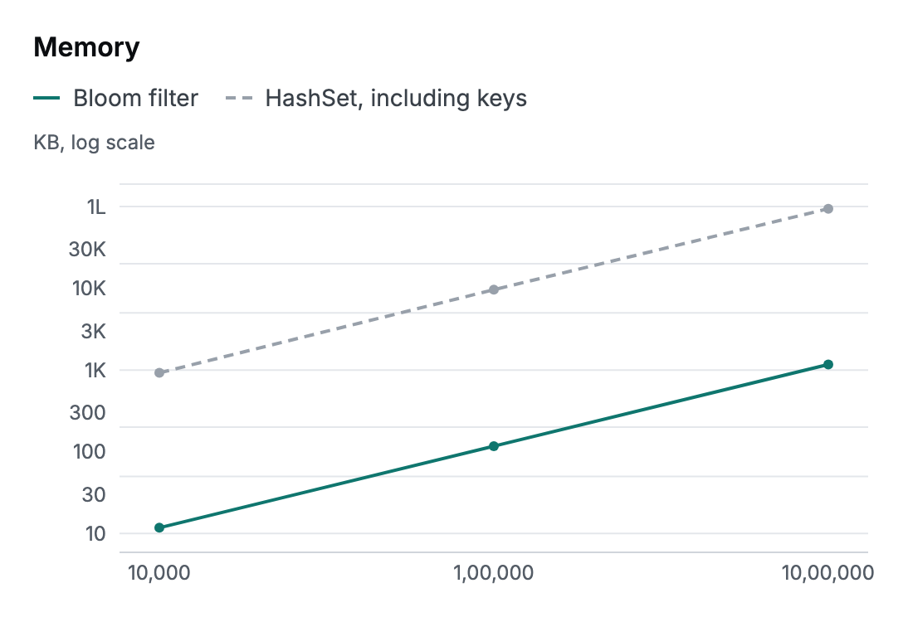
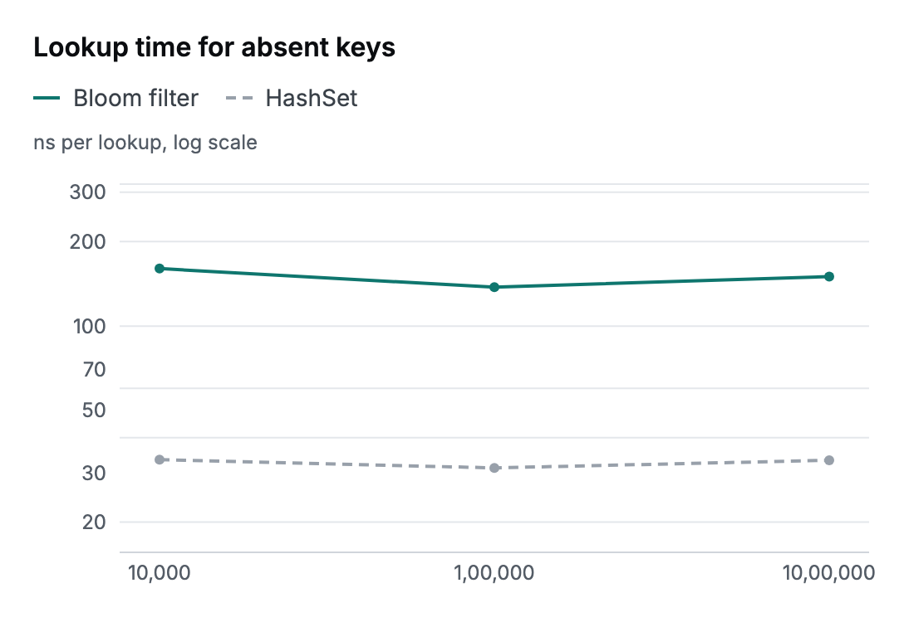
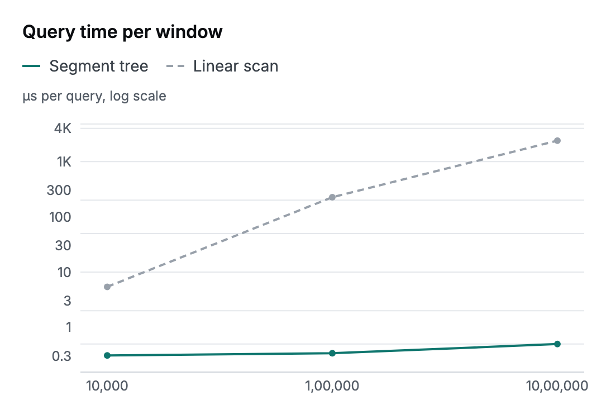
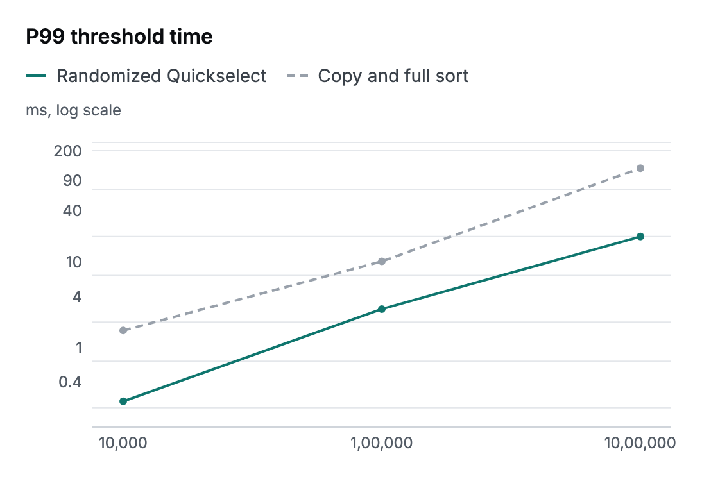

# 6. Benchmarks

Code: `com.txnscreen.bench` (`BenchmarkRunner`, `Timer`, `BloomBench`, `RangeBench`, `SelectBench`) and the
baselines in `com.txnscreen.baseline` (`HashSetMembership`, `LinearRangeScan`, `SortPercentile`). Results:
`docs/benchmarks/results.json`, with the machine in `docs/benchmarks/machine.md`.

Each algorithm is measured against the simple method it replaces, at 10,000, 100,000 and 1,000,000 rows or
keys. This section gives the method once, then the three comparisons side by side, then where each
algorithm does not help. Sections 3.8, 4.7 and 5.8 discuss each algorithm's results in more depth.

## 6.1 What is compared

| Benchmark | Our algorithm | Baseline | Question | Measured |
| --- | --- | --- | --- | --- |
| `membership` | `BloomFilter`, sized for p = 0.01 | `HashSetMembership`, a presized `HashSet<String>` | Is this key in the set? | memory, insert time, lookup time for present and absent keys, measured and theoretical false positive rate, false negatives |
| `range` | `TimeWindowIndex`, a segment tree over 60-second buckets | `LinearRangeScan` over every row | Sum, count and maximum of a time window | build time, query time, point update time, bucket count, windows where the two disagree |
| `selection` | `RandomizedQuickselect` | `SortPercentile`: copy, `Arrays.sort`, read the index | P95 and P99 amount | time, comparisons, comparisons per value, the value found |

## 6.2 Method

### Machine and JVM

The results were measured once, on 16 Nov 2026 at 22:00 IST, at commit `a6c6ba6`. No file under
`algo/`, `bench/`, `baseline/` or `data/` has changed since that commit, so the results still describe the
current code.

| Item | Value |
| --- | --- |
| Laptop | Lenovo 83DV, on AC power, other apps closed |
| CPU | 13th Gen Intel Core i7-13650HX, 14 cores, 20 threads |
| RAM | 24 GB |
| OS | Windows 11 Home Single Language, version 10.0.26200 |
| JDK | Microsoft Build of OpenJDK 25.0.4.1 (OpenJDK 64-Bit Server VM), compiling for Java 21 |
| Heap | `MAVEN_OPTS=-Xmx3g`, so a maximum heap of 3,072 MB |

The benchmarks run inside the Maven JVM through `exec:java`, which is why the heap is set with `MAVEN_OPTS`.
The deployed API runs on a Java 21 runtime instead, so its timings would differ. That does not change the
comparisons, which are between methods measured on the same JVM.

### Command

From `backend/`, in Git Bash:

```bash
export MAVEN_OPTS=-Xmx3g
./mvnw -q compile exec:java -Dexec.mainClass=com.txnscreen.bench.BenchmarkRunner \
  -Dexec.args="--sizes 10000,100000,1000000 --repeats 7 --warmup 3 --seed 42 \
  --machine 'Intel Core i7-13650HX (14 cores, 20 threads), 24 GB RAM, Lenovo 83DV laptop on AC power' \
  --commit $(git rev-parse --short HEAD) --out ../docs/benchmarks/results.json"
```

In PowerShell, set the heap with `$env:MAVEN_OPTS="-Xmx3g"` instead of `export`. The runner writes the
environment, the settings and every measurement to `results.json`. The frontend copies that file at build
time, and the Benchmarks page draws its charts and tables from it.

### Timing

- **Warmup and repeats.** `Timer` runs each piece of work 3 times untimed, so the JIT compiles it, and then 7
  times timed with `System.nanoTime`.
- **Median.** The reported value is the median of the 7 timed runs. The minimum and maximum are kept in the
  file too. The median is used because single runs can be far off: one of the 7 full sorts of 100,000 equal
  amounts took 41.1 ms against a median of 0.3186 ms, and one HashSet insert of 1,000,000 keys took 436.0 ms
  against a median of 148.2 ms.
- **Per operation.** Lookups, window queries and point updates are too fast to time one at a time, so a
  batch is timed and divided by its size: all n present or all n absent keys, 1,000 windows, or 10,000
  updates.
- **Dead code.** Each timed result is written to a `volatile` field, so the JIT cannot decide the work is
  unused and remove it.
- **Order.** One JVM runs every benchmark in turn: membership, range, then selection, each at 10,000,
  100,000 and 1,000,000.

### Data and seeds

Every input comes from seed 42, so every run of the command measures the same inputs.

- **Membership.** n present keys `ACC000000`, `ACC000001`, ... and n absent keys `ZZZ000000`, ..., the
  same length as the generated account IDs, inserted and queried in an order shuffled by the seed. Present
  keys are queried through separate `String` objects with the same text, as parsed rows would be. The seed is
  also the MurmurHash3 seed.
- **Range.** n rows from the synthetic generator (duplicate rate 0.02, blacklist rate 0.05) over 30 days.
  1,000 random windows that start and end on bucket boundaries, and 10,000 point updates that copy existing
  rows into a separate index, so no update triggers a rebuild.
- **Selection.** The amounts of n generated rows, at P95 and P99, plus an array of n amounts all equal to
  500.00 rupees, at P99. Times use pivot seed 42. Comparison counts are taken with 25 pivot seeds, 42 to 66,
  and the median, minimum and maximum are recorded.

### Checks before recording

Each benchmark checks that the answers are right before it records a time, and stops without writing any
results if they are not:

- every present key must be reported as possibly present by the Bloom filter;
- every one of the 1,000 windows must give the same sum, count and maximum from the segment tree and from
  the linear scan;
- Quickselect and the sort must return the same value in every case.

### Memory

Memory is measured with JOL's `GraphLayout`, the size of the whole object graph. The HashSet is reported
including the key strings and excluding them. These are object sizes on the heap, not the memory of the
process. On this JDK, JOL prints warnings that it cannot attach its agent, and still reports the sizes.

### Reading the charts

The charts below are exported from the app's Benchmarks page, which draws them from `results.json`. Both
axes use the page's Indian number format: 1,00,000 is 100,000, 10,00,000 is 1,000,000, and "1L" on an axis
is one lakh, 100,000. The y axis is logarithmic, so equal vertical steps are equal ratios. Our algorithm is
the solid line and the baseline is dashed.

## 6.3 Membership: Bloom filter against HashSet





| n (keys) | Bloom filter (bytes) | HashSet with keys (bytes) | HashSet / Bloom | Measured FPR | Theoretical FPR | False negatives |
| ---: | ---: | ---: | ---: | ---: | ---: | ---: |
| 10,000 | 12,048 | 945,648 | 78.5 | 0.01000 | 0.010039 | 0 |
| 100,000 | 119,880 | 9,848,688 | 82.2 | 0.01012 | 0.010039 | 0 |
| 1,000,000 | 1,198,200 | 96,388,720 | 80.4 | 0.00999 | 0.010039 | 0 |

| n (keys) | Insert all, Bloom (ms) | Insert all, HashSet (ms) | Present key, Bloom (ns) | Present key, HashSet (ns) | Absent key, Bloom (ns) | Absent key, HashSet (ns) |
| ---: | ---: | ---: | ---: | ---: | ---: | ---: |
| 10,000 | 1.9107 | 0.8190 | 219.48 | 133.08 | 160.29 | 33.39 |
| 100,000 | 15.6593 | 4.8343 | 154.982 | 148.478 | 137.584 | 31.213 |
| 1,000,000 | 300.2371 | 148.1858 | 207.5555 | 307.4266 | 149.9697 | 33.222 |

The filter used about 80 times less memory than a HashSet holding the same keys, and its measured false
positive rate was within 1% of the theoretical rate at every size, with no false negatives. It was slower
than the HashSet everywhere except present-key lookups at 1,000,000 keys: inserts took 2.0 to 3.2 times as
long, and absent-key lookups 4.4 to 4.8 times as long. Section 3.8 has the details.

## 6.4 Range queries: segment tree against linear scan



| n (rows) | Buckets B | Build (ms) | Segment tree query (µs) | Linear scan query (µs) | Scan / tree | Point update (ns) | Mismatched windows |
| ---: | ---: | ---: | ---: | ---: | ---: | ---: | ---: |
| 10,000 | 43,138 | 0.7204 | 0.3101 | 5.4096 | 17.4 | 121.57 | 0 |
| 100,000 | 43,196 | 3.1349 | 0.3402 | 226.3171 | 665.2 | 192.19 | 0 |
| 1,000,000 | 43,200 | 42.2908 | 0.4981 | 2,390.6988 | 4,799.6 | 281.49 | 0 |

As n grew 100 times, the linear scan grew about 442 times and the segment tree query went from 0.3101 to
0.4981 µs. Every window gave the same answer from both methods. Section 4.7 has the details.

## 6.5 Percentile selection: Quickselect against full sort



| n (amounts) | Quickselect P95 (ms) | Sort P95 (ms) | Quickselect P99 (ms) | Sort P99 (ms) | Comparisons / n, P95 | Comparisons / n, P99 |
| ---: | ---: | ---: | ---: | ---: | ---: | ---: |
| 10,000 | 0.3172 | 1.4094 | 0.2377 | 1.5948 | 3.35 | 2.89 |
| 100,000 | 3.0117 | 10.3991 | 2.8391 | 10.2225 | 3.28 | 2.95 |
| 1,000,000 | 18.2942 | 124.9191 | 19.9412 | 125.3417 | 3.09 | 2.96 |

| n (amounts) | Quickselect, all equal (ms) | Sort, all equal (ms) | Comparisons / n, all equal |
| ---: | ---: | ---: | ---: |
| 10,000 | 0.0689 | 0.2042 | 2.00 |
| 100,000 | 0.6292 | 0.3186 | 2.00 |
| 1,000,000 | 8.6129 | 5.7738 | 2.00 |

On the generated amounts, Quickselect was 3.5 to 6.8 times faster than the sort, and its comparisons per
value stayed roughly constant as n grew 100 times, which is the sign of linear work. Both always returned
the same value. Section 5.8 has the details.

## 6.6 Where each algorithm does not help

**Bloom filter.**

- **Speed against an in-memory set.** A HashSet in the same JVM was faster for inserts and for absent-key
  lookups at every size. A Java `String` caches its hash code, so a repeated HashSet lookup does not hash the
  key again, while the filter runs MurmurHash3 on every query. The filter's benefit is memory, and the exact
  lookups it avoids when the exact store is slow, such as a database or a remote service.
- **Inside TxnScreen itself.** Both exact stores are in-memory `HashSet` and `HashMap` objects, so the
  filters add memory here rather than save it. The app models the setup where they would pay off, and
  reports the lookups they avoided.
- **Small blacklists.** A blacklist of a few accounts gets a filter of a few dozen bits, and repeated
  transactions from one unlucky account repeat its false positive. On the 1K sample the blacklist filter's
  measured rate was 4.97% against 0.93% theoretical (section 3.9).

**Segment tree.**

- **One or two queries on a small run.** At 10,000 rows, building the tree cost as much as about 142 linear
  scans, so a single window is faster with a plain scan. The tree pays off on the run page, which asks for
  120 windows for its charts, and on every later query. At 100,000 and 1,000,000 rows it paid for itself
  after 14 and 18 queries.
- **Answers to the second.** The tree answers whole buckets, so a window that starts or ends inside a bucket
  includes all of it. The linear scan is exact to the second.

**Quickselect.**

- **Input that is already in order.** With every amount equal, the sort was faster at 100,000 and 1,000,000
  values, because Java's sort detects ordered input and returns after one scan. Quickselect does not detect
  order, although it still finished in one linear pass.
- **Many percentiles of the same amounts.** Each percentile runs Quickselect again, while one sort serves
  every later percentile with an array read. From the P99 medians, one sort cost as much as 6.7, 3.6 and 6.3
  selections at the three sizes, so 7, 4 and 7 or more percentiles of the same unchanged amounts would be
  cheaper with one sorted copy.
- **Small runs.** At 10,000 amounts both methods took under 2 ms. The difference is real but too small for a
  user of the run page to notice.

## 6.7 Against the proposal's success criteria

| Criterion | Result |
| --- | --- |
| Zero false negatives on blacklisted and duplicate items, checked against the generator's labels | Met. The membership benchmark found every present key at every size, and `ScreeningServiceTest` checks that the 10K sample's `BLACKLISTED` and `DUPLICATE` flags match its labels exactly |
| Measured Bloom filter false positive rate within 20% of the theoretical value at 100K and 1M | Met. +0.80% at 100,000 keys and -0.49% at 1,000,000 |
| Range query time growing logarithmically with bucket count | Not shown. The generated data always spans 30 days, so B is about 43,200 at every size, and the benchmark does not vary B (section 4.7) |
| Documented speedup against the HashSet, linear scan and full sort baselines, with memory also compared against HashSet | Documented above. The segment tree was 17 to 4,800 times faster than the scan and Quickselect 3.5 to 6.8 times faster than the sort. The Bloom filter used about 80 times less memory than the HashSet but was not faster |

## 6.8 Limits of these measurements

- **One machine, one run.** Every number comes from one run of the command on one laptop. Absolute times
  will differ elsewhere, so the results are for comparing methods with each other.
- **A hand-written harness.** `Timer` is a simple warmup-then-measure loop, not a harness such as JMH. Three
  warmup runs may not bring every method to its fully compiled state, and the median of 7 runs smooths
  over garbage collection pauses rather than controlling them.
- **Shared JVM.** All three benchmarks run one after another in one JVM, so the JIT and the heap carry state
  from earlier measurements into later ones.
- **Sizes beyond the app.** Uploads and generated runs are limited to 200,000 rows. The 1,000,000 row results
  show how each method scales, not a size the app screens.
- **One time span.** The range benchmark always has about 43,200 buckets, so it shows the effect of n but
  not of B.
- **Unexplained points.** Some results are not explained by the analysis, such as the full sort of 10,000
  equal amounts taking about 20 ns per value against 3 ns at 100,000, and segment tree query time rising from
  0.3101 to 0.4981 µs with the tree the same shape at every size. We did not measure their causes.
