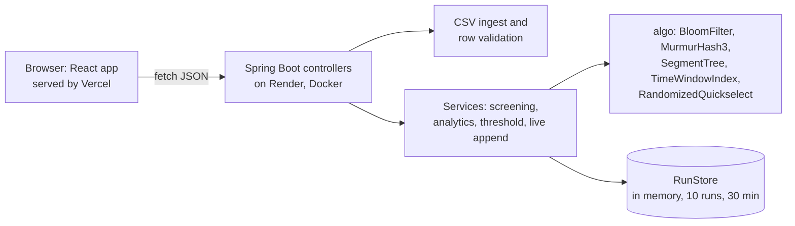
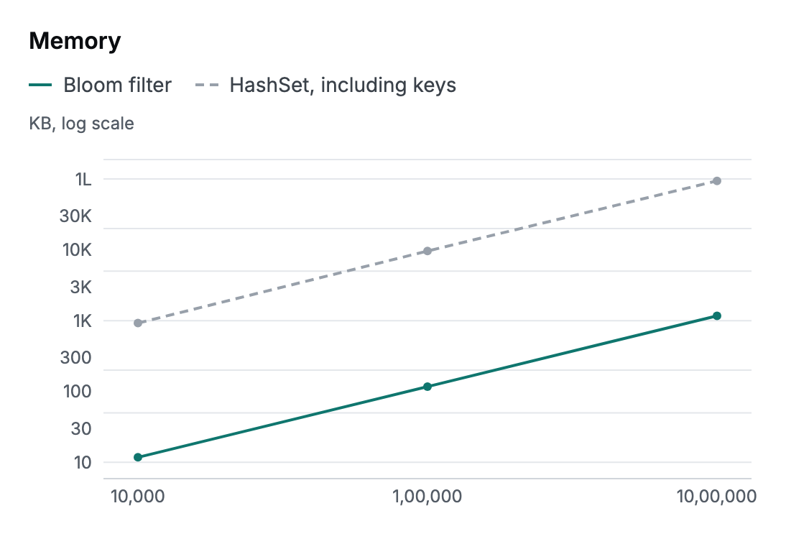
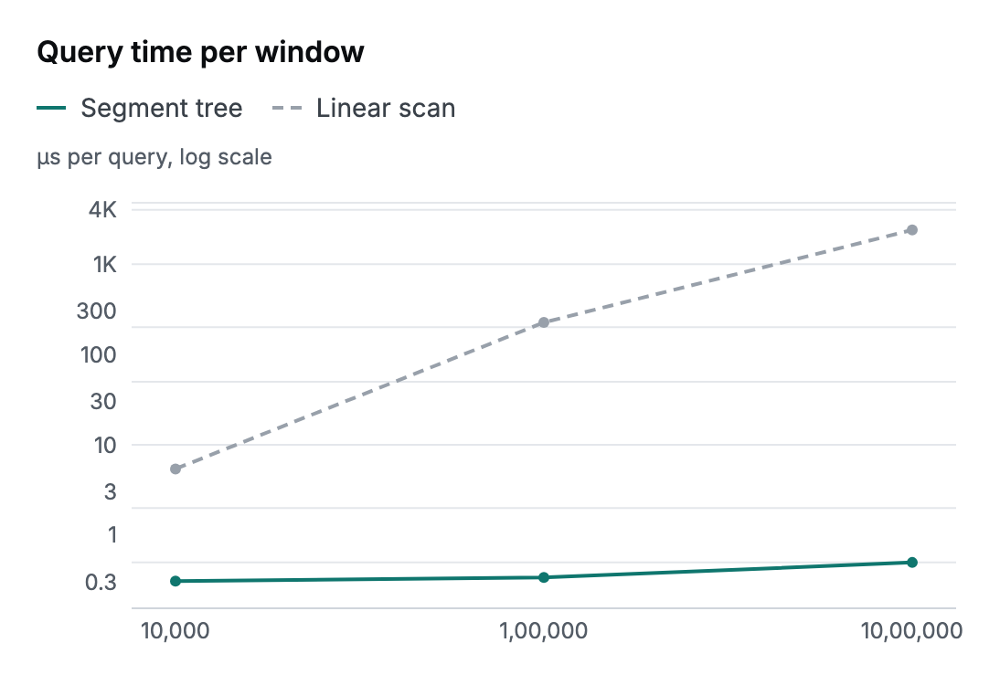
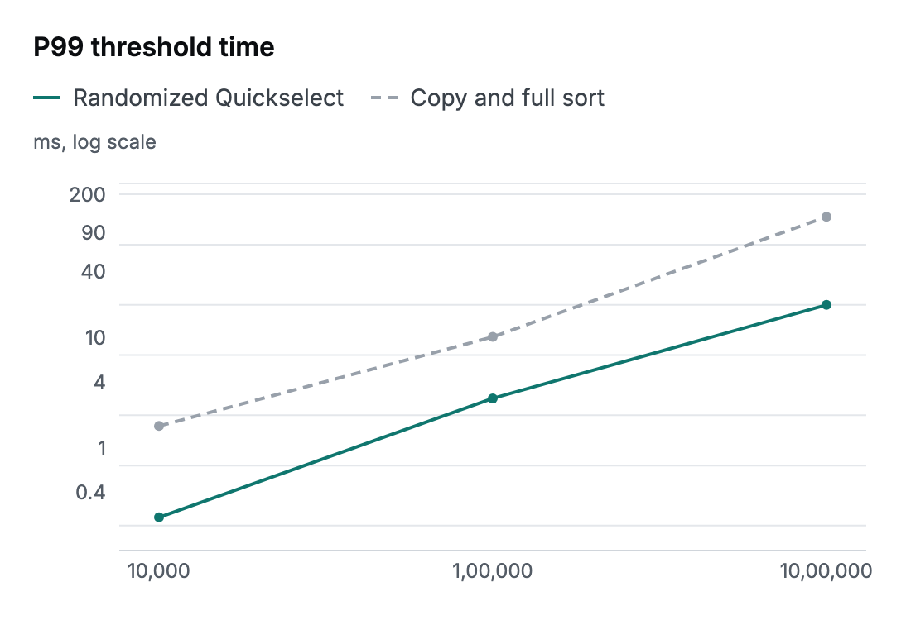

# TxnScreen: Technical Report

**A fraud and duplicate transaction screener.** Advanced Algorithm course (CIA 3), ATLAS uGDX School of
Technology. Krrish, Hardik and Vedant. 19 November 2026.

Repository: https://github.com/Krrishkothari/Fraud-and-Duplicate-Transaction-Screener. This report
condenses the full sections in `docs/report/` (01 to 08), which give every proof, table and test in
detail. All measured numbers come from `docs/benchmarks/results.json`.

## 1. Problem

A payments team receives files of transactions and must catch three kinds of row before money moves on:
**duplicate** transaction IDs, transactions from **blacklisted** accounts, and **unusually large** amounts
relative to the file itself. Analysts also need the total, count and largest amount for any time window,
including windows that change as new transactions arrive. Naive methods are slow at scale: comparing
each row with every earlier row, scanning every row per window, sorting every amount per percentile.

| Question | Algorithm (our own Java code) | Syllabus |
| --- | --- | --- |
| Is this account blacklisted? Is this ID a repeat? | Bloom filter precheck, every hit confirmed exactly | Unit 6, CO5 |
| Total, count and maximum for a time window? | Segment tree over time buckets, with point updates | Unit 3 |
| What is the P99 (or any percentile) amount? | Randomized Quickselect, three-way partition | Unit 6, CO5 |

**Users** are fraud analysts and payments operations staff. **Input** is a CSV with the header
`transaction_id,account_id,amount,timestamp,merchant` (amounts in rupees with at most 2 decimals,
ISO-8601 timestamps with an offset) and an optional one-column blacklist, or server-generated seeded
sample data. **Output** is JSON: a run summary, paged flags with plain reasons, rejected rows, window and
series totals, and thresholds.

**Key assumptions.** A duplicate is a repeated `transaction_id`; its first occurrence is its earliest row
in time. Blacklist matching is exact. Money is stored as `long` paise, never floating point.

**Failure cases** never fail silently. A bad request gets one error shape, `{code, message, details}`: for
example `EMPTY_FILE`, `BAD_HEADER` and `INVALID_CONFIG` (400), `FILE_TOO_LARGE` (413, above 200,000 rows
or 20 MB), `NO_VALID_ROWS` (422) and `RUN_NOT_FOUND` (404). A bad row is rejected and listed with its line
and reason (`MISSING_FIELD`, `INVALID_AMOUNT`, `AMOUNT_NOT_POSITIVE`, `INVALID_TIMESTAMP`) while the rest
is screened. Windows outside the data give `WINDOW_OUT_OF_RANGE`; windows partly outside are clamped and
marked `clamped: true`. Every case but the generic 500 error has a test (`01-problem.md`, section 1.7, lists them).

## 2. Architecture

The browser only sends requests and displays results; every algorithm runs in the Java API. Creating a
run (`POST /api/runs`) parses the CSV, screens every valid row in time order with the two Bloom filters,
computes the threshold with Quickselect, builds the segment tree index, and stores the run in memory.
Later requests query that run: `/window` and `/series` use the segment tree, `/threshold` runs
Quickselect on a time slice, and `POST /transactions` screens one live transaction and applies a point
update. Window queries and appends on one run share a lock. The free Render tier (512 MB) is why uploads
are capped at 200,000 rows and the 1M benchmarks run locally. The full API with real responses is in
`docs/api.md`.

## 3. Bloom filter screening (Krrish)

**Why.** Most accounts are not blacklisted and most IDs are new. A Bloom filter answers "definitely not
present" in O(k) with about 9.6 bits per key at p = 0.01, whatever the key length. A "possibly present"
answer goes to an exact store (a `HashSet` of the blacklist, a `HashMap` of seen IDs to their first line),
and **only confirmed hits become flags**, so the flags are exact.

**Sizing.** For n keys and target rate p: m = ceil(-n ln p / (ln 2)^2) bits and k = max(1, round(m/n ln 2))
hashes, with p_theory = (1 - e^(-kn/m))^k. For n = 1,000,000 and p = 0.01, m = 9,585,059 bits
(1,198,136 bytes) and k = 7.

**Hashing.** Our MurmurHash3 x64 128-bit, checked against Guava in test scope on 2,000 random strings,
gives h1 and h2 once per key. Probe i is floorMod(h1 + i h2, m) (Kirsch and Mitzenmacher double hashing).
Bits live in a `long[]` of ceil(m/64) words.

**Correctness.** Bits are never cleared, and the same key always hashes to the same k positions, so an
added key is always reported as possibly present: **no false negatives**. A false positive is removed by
the exact store, so no wrong flag is raised. An overfilled filter (more keys than designed, or estimated
rate fill^k above twice the target) only sends more keys to the exact store; the run reports
`saturated: true` and a suggested size. Tests check that the 10K sample's flags match the generator's
labels exactly.

| n (keys) | Theoretical FPR | Measured FPR | Bloom memory (bytes) | HashSet with keys (bytes) | Ratio |
| ---: | ---: | ---: | ---: | ---: | ---: |
| 10,000 | 0.010039 | 0.01000 | 12,048 | 945,648 | 78.5 |
| 100,000 | 0.010039 | 0.01012 | 119,880 | 9,848,688 | 82.2 |
| 1,000,000 | 0.010039 | 0.00999 | 1,198,200 | 96,388,720 | 80.4 |

The measured rate was within 1% of theory at every size, and the filter used about 80 times less memory
than a HashSet. It was **not faster** than an in-memory HashSet: absent-key lookups took about 150 ns
against 33 ns. Its value is memory and the exact lookups it avoids when the exact store is slow.

## 4. Segment tree for time windows (Hardik)

**Buckets.** With width w (default 60 s) and t0 = floorDiv(min timestamp, w) × w, a timestamp ts falls in
bucket (ts - t0) / w. Each leaf holds its bucket's sum, count and maximum, all `long` paise.

**Tree.** An iterative tree in three arrays of length 2C, where C is the bucket count B rounded up to a
power of two; node i has children 2i and 2i + 1. Nodes merge as (a.sum + b.sum, a.count + b.count,
max(a.max, b.max)) with identity (0, 0, 0). Build is bottom-up in O(B); `add` updates one leaf and its
ancestors in O(log B); `query(l, r)` walks up from both ends, merging a boundary node whenever its parent
would extend past the range, in O(log B).

**Correctness.** Every internal node equals the merge of its children: build establishes it bottom-up,
and `add` recomputes exactly the changed leaf's ancestors. A query moves each boundary node out of the
remaining range into the result, so merged nodes are disjoint, at most 2 per level: O(log B) disjoint
nodes covering exactly leaves l to r. Merge is associative and commutative, so order does not matter.

**Windows and growth.** A window is clamped to the data range; one entirely outside is rejected. A live
transaction past the last bucket doubles the capacity and rebuilds; total rebuild work is less than twice
the final capacity, so growth is O(1) amortized per append when transactions arrive in time order.

| n (rows) | Buckets B | Build (ms) | Tree query (µs) | Linear scan (µs) | Update (ns) | Mismatches |
| ---: | ---: | ---: | ---: | ---: | ---: | ---: |
| 10,000 | 43,138 | 0.7204 | 0.3101 | 5.4096 | 121.57 | 0 |
| 100,000 | 43,196 | 3.1349 | 0.3402 | 226.3171 | 192.19 | 0 |
| 1,000,000 | 43,200 | 42.2908 | 0.4981 | 2,390.6988 | 281.49 | 0 |

All 1,000 random windows matched the linear scan at every size. As n grew 100 times, the scan grew about
442 times while the tree query stayed under 0.5 µs, 4,800 times faster at 1M rows. At 10K rows the build
costs about 142 scans, so a single query on a small run does not need a tree.

## 5. Randomized Quickselect for the risk threshold (Vedant)

**Rank.** Nearest-rank: for n amounts and percentile p, k = ceil(p / 100 × n), computed exactly with
`BigDecimal`. Amounts strictly above the k-th smallest get a `HIGH_AMOUNT` flag.

**Algorithm.** On a copy of the amounts, repeat over [lo, hi]: pick a pivot uniformly at random from a
seeded `java.util.Random`, partition three ways into less, equal and greater, then return the pivot if k is
in the equal block, or continue on the side holding k. **Invariant:** the target index k - 1 stays inside
[lo, hi], and every value left of lo is smaller and every value right of hi larger than all values in
[lo, hi], so the k-th smallest value is always inside the range and the returned pivot is correct.

**Complexity.** Expected O(n): a random pivot is often near the middle, so the range shrinks by a
constant factor in expectation and the work forms a geometric series. The worst case is O(n^2), with
vanishing probability for random pivots, which no fixed input can force. The three-way partition
finishes an all-equal array in one pass instead of degrading to quadratic.

| n (amounts) | Quickselect P99 (ms) | Sort P99 (ms) | Sort / Quickselect | Comparisons / n, P99 |
| ---: | ---: | ---: | ---: | ---: |
| 10,000 | 0.2377 | 1.5948 | 6.7 | 2.89 |
| 100,000 | 2.8391 | 10.2225 | 3.6 | 2.95 |
| 1,000,000 | 19.9412 | 125.3417 | 6.3 | 2.96 |

Both methods returned the same value at every size. Comparisons per value stayed near 3 as n grew 100
times, the linear behaviour the analysis predicts (median over 25 pivot seeds). With all amounts equal,
Quickselect made exactly 2n comparisons, but Java's sort, which detects ordered input, was faster at
100K and 1M.

## 6. Benchmarks

**Method.** One laptop (Intel Core i7-13650HX, 24 GB RAM, Windows 11) on AC power, OpenJDK 25.0.4.1 with
`-Xmx3g`, commit `a6c6ba6`. Sizes 10,000, 100,000 and 1,000,000; 3 untimed warmup runs, then the median of
7 timed runs; seed 42 for all data; JOL for memory. Each benchmark checks that our algorithm and its
baseline agree before recording anything. The exact command is in `docs/benchmarks/machine.md`, and the
Benchmarks page draws its charts from the same file.

| Proposal success criterion | Result |
| --- | --- |
| Zero false negatives on blacklisted and duplicate items | **Met**, in the benchmark and against the 10K sample's labels |
| Measured Bloom FPR within 20% of theory at 100K and 1M | **Met**: +0.80% and -0.49% |
| Range query time growing logarithmically with bucket count | **Not shown**: the data always spans 30 days, so B is about 43,200 at every size |
| Documented speedup against the baselines | **Documented**: segment tree 17 to 4,800 times faster than the scan, Quickselect 3.5 to 6.8 times faster than the sort, Bloom filter about 80 times smaller than a HashSet but not faster |

## 7. Limitations

- **In-memory runs.** No database: runs last 30 minutes, at most 10 are kept, and all are lost on a
  restart or when the free host sleeps. One server process holds every run, so the API cannot scale out
  without a shared store.
- **What counts as suspicious.** Duplicates are exact ID matches only, so a resubmitted payment with a new
  ID is missed. Blacklist matching is exact. The threshold is one percentile of the whole run, with no
  per-account history, and it is not recomputed when a live transaction is appended.
- **Bloom filter.** No deletion (a counting Bloom filter would be needed); fixed size; and inside this app
  the exact stores are also in memory, so the filters model a precheck in front of a slow store rather
  than saving memory here.
- **Segment tree.** Answers are exact to the bucket width; the index cannot grow to the left.
- **Quickselect.** Each new percentile costs O(n) again; for about 7 or more percentiles of the same
  amounts one sort is cheaper. The pivot seed is visible, so a crafted file could slow, never break, a run.
- **Measurements.** One machine, one run, a simple harness rather than JMH, synthetic data only.

## 8. Contributions

Each person owned one algorithm end to end. Commits are listed under whoever made them on `main`.

| Person | Owned algorithm | Plan commits | Built |
| --- | --- | --- | --- |
| Krrish | Bloom filter, MurmurHash3, screening pipeline | K01 to K13, V13, V15, plus 5 outside the plan (20) | Backend skeleton, domain model and errors, hash and Bloom filter with tests, CSV ingest, screening with exact confirmation, run API and store, Bloom plan endpoint, run page, flagged table, Bloom panel, Bloom benchmark, ingestion tests, Home and Method pages, Vercel config, Quickselect and benchmark report sections |
| Hardik | Segment tree and time-window analytics | H01 to H11, H13, H14, K15, H15, plus 1 outside the plan (16) | Proposal, CI, segment tree and time-bucket index with tests, window and series endpoints, live append, charts and window form, live transaction form, range benchmark, integration tests, Privacy and Terms, architecture, API, segment tree and Bloom report sections, README, this report and the demo script |
| Vedant | Randomized Quickselect, synthetic data, benchmarks | V01 to V12, K14, V14 (14) | Frontend scaffold and design system, Quickselect with tests, synthetic data generator and samples, threshold service, API client and Screen page, threshold panel, benchmark harness, selection benchmark, Benchmarks page and results, threshold tests, Dockerfile and Render config, accessibility pass |

H12 (custom domain for the deployed site) is not done yet. Commit hashes for every ID are in
`docs/report/08-contributions.md`.
